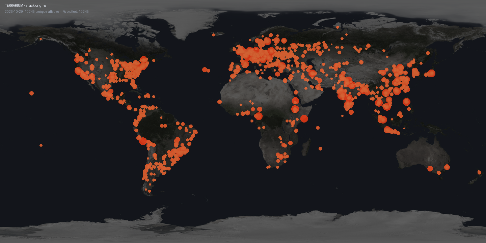

# Attack map

Updated daily from the deception grid.

| Metric | Count |
|---|---|
| Unique attacker IPs | 5805 |
| SSH brute-forcers | 2586 |
| HTTP probers | 2729 |
| Jenkins probers | 1055 |

## Top origin countries (by events)

| Country | Events |
|---|---|
| US | 1616180 |
| NL | 1350938 |
| FR | 284519 |
| CA | 119199 |
| HK | 78942 |
| IN | 42480 |
| AD | 30430 |
| SO | 21677 |

_Last updated: 2026-10-16 UTC_
