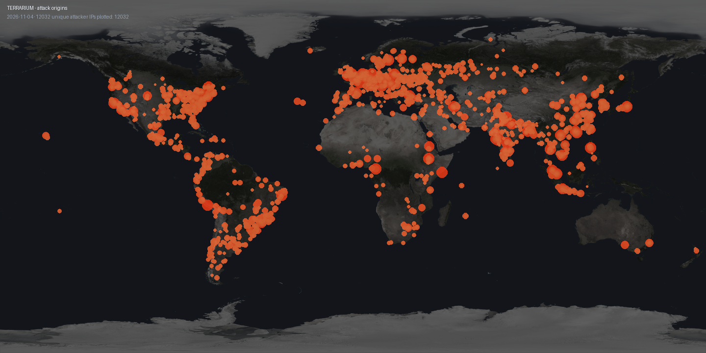

# Attack map

Updated daily from the deception grid.

| Metric | Count |
|---|---|
| Unique attacker IPs | 14224 |
| SSH brute-forcers | 6686 |
| HTTP probers | 6637 |
| Jenkins probers | 2216 |

## Top origin countries (by events)

| Country | Events |
|---|---|
| NL | 2950162 |
| US | 2543821 |
| IN | 1060714 |
| FR | 641110 |
| AD | 159246 |
| CA | 122968 |
| HK | 93949 |
| PE | 85808 |

_Last updated: 2026-11-10 UTC_
