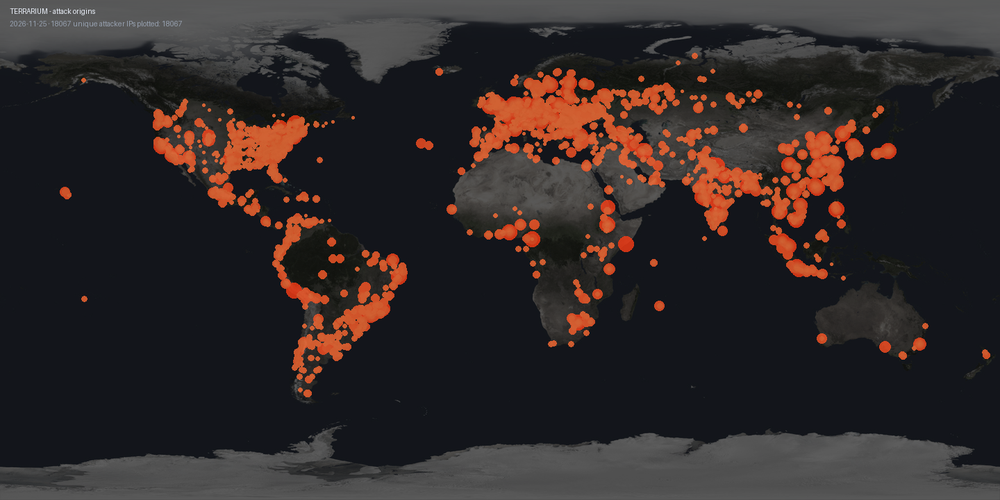

# Attack map

Updated daily from the deception grid.

| Metric | Count |
|---|---|
| Unique attacker IPs | 18371 |
| SSH brute-forcers | 8344 |
| HTTP probers | 8809 |
| Jenkins probers | 3076 |

## Top origin countries (by events)

| Country | Events |
|---|---|
| NL | 3833448 |
| US | 3245475 |
| IN | 1342191 |
| FR | 818851 |
| AD | 338347 |
| UA | 140694 |
| CA | 129077 |
| GE | 126892 |

_Last updated: 2026-11-26 UTC_
